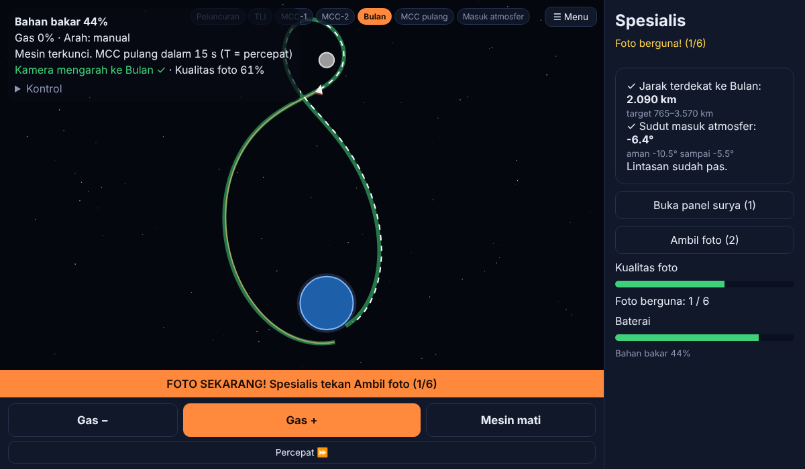
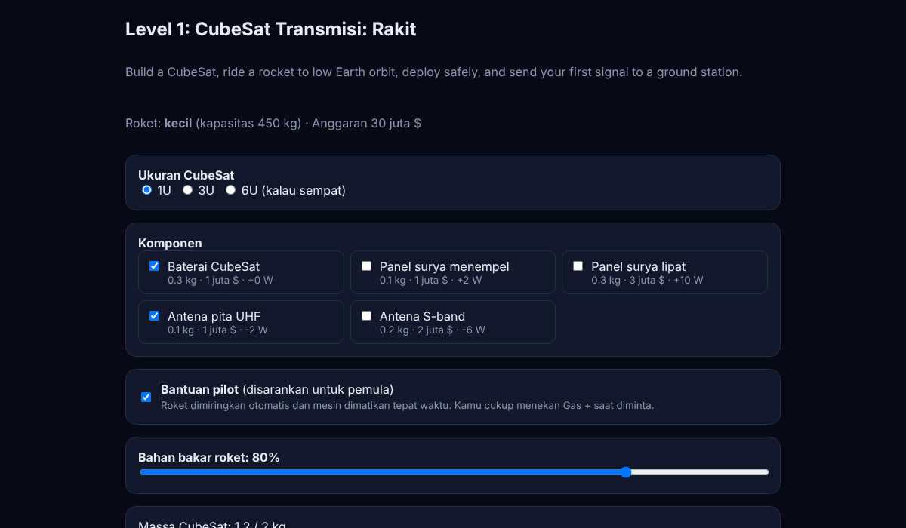
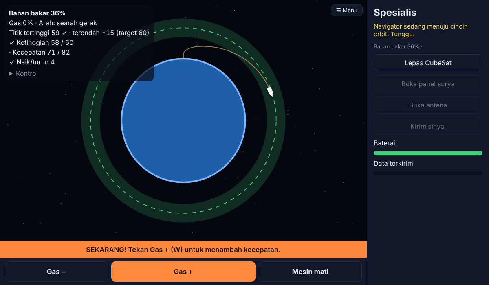

# Roket Geprek

**Rancang wahanamu, lalu terbangkan misinya berdua.** Roket Geprek adalah game web tentang desain misi luar angkasa untuk NASA Space Apps Challenge 2026 (challenge *Space Mission Design Game*), dibuat di Bandung.

Satu pemain jadi **Navigator** yang menyetir roket, satu lagi jadi **Spesialis** yang mengoperasikan wahana. Masing-masing memakai perangkatnya sendiri dan bergabung lewat kode room. Setiap pilihan di layar Rakit (massa, daya, bahan bakar, anggaran) langsung terasa saat terbang.

▶ **Main sekarang:** **https://roket-geprek.web.app** (cadangan: https://roket-geprek.vercel.app)



## Level

| Level | Misi | Yang dipelajari | Status |
|---|---|---|---|
| 1. CubeSat Transmisi | Rakit CubeSat, bawa ke orbit rendah Bumi, kirim sinyal pertama | Gravity turn, kecepatan orbit, aturan pelepasan CubeSat, jendela stasiun Bumi | Bisa dimainkan |
| 2. Memutari Bulan | Terbang memutari Bulan dan pulang, terinspirasi Artemis II | Lintasan *free return*, koreksi lintasan (MCC), koridor masuk atmosfer | Bisa dimainkan |
| 3. Kutub Selatan Bulan | Masuk orbit Bulan, pilih titik pendaratan, mendarat, lalu cari es dan kirim data | Mendarat tanpa atmosfer, bayangan panjang di kutub, daya dan arah antena | Bisa dimainkan |
| 4. Mendarat di Mars | Bawa rover ke Mars, hindari badai matahari, program pendaratannya, kirim foto pertama | Jeda sinyal, pendaratan otomatis ("tujuh menit penuh ketegangan"), atmosfer tipis | Bisa dimainkan |

<table><tr>
<td></td>
<td></td>
</tr><tr>
<td align="center">Rakit: massa, anggaran, slot</td>
<td align="center">Level 1: menuju cincin orbit</td>
</tr></table>

## Cara main

1. **Lobby:** pilih *Main solo* (satu perangkat), atau *Buat room* (Navigator) lalu bagikan kode 4 huruf ke Spesialis yang menekan *Gabung*.
2. **Pilih misi:** semua level yang sudah tersedia bisa langsung dipilih, tidak perlu berurutan. Bintang terbaik tersimpan di browser.
3. **Rakit:** pilih komponen. Bar massa, anggaran, dan slot harus hijau.
4. **Terbang:** Navigator mengatur gas dan arah, Spesialis membuka panel, mengirim sinyal, memotret, dan membaca prediksi lintasan.
5. **Debrief:** bintang, skor, alasan gagal, dan misi NASA nyata yang mirip.

**Dana misi:** misi yang berhasil dan hemat memberi dana (bintang, sisa anggaran, bonus orbit tepat atau foto lengkap). Dana cadangan bisa ditambahkan ke anggaran misi berikutnya di layar Rakit, maksimal 50% anggaran level, seperti misi sungguhan yang mendapat pendanaan lanjutan.

**Bantuan pilot** (default nyala) mengatur arah roket secara otomatis, dan pemandu misi **Pok-Pok** memberi tahu kapan harus menekan tombol. Kalau dimatikan di layar Rakit (mode ahli), roket tetap miring sendiri saat ke orbit, tapi pemain menentukan sendiri kapan menyalakan mesin.

**Pengaturan** (ikon gerigi): pilih tampilan 3D atau 2D, dan hapus progres.

### Kontrol Navigator

Semua tombol cukup diketuk. Di HP tersedia tombol besar di layar.

| Tombol | Fungsi |
|---|---|
| W / S | gas naik / turun 25% |
| Spasi / X | mesin nyala-mati / matikan mesin |
| F | dorongan pendek (koreksi kecil) |
| A / D | putar 15° |
| Q / E | arahkan searah / lawan arah gerak |
| Z / C | arahkan ke kiri / kanan jalur (Level 2) |
| T | percepat waktu saat mesin mati |
| Esc / P | menu jeda |

Spesialis di Level 2: **1** buka panel surya, **2** ambil foto. Di Level 3 dan 4, tombol Spesialis ada di panel kanan (pilih titik pendaratan, pindai es, arahkan antena, atur parasut, kirim foto).

## Akurasi sains

Mekanik utama mengikuti cara kerja misi sungguhan, dengan penyederhanaan supaya bisa dimainkan:

- Masuk orbit butuh kecepatan ke samping (gravity turn), bukan sekadar naik tinggi.
- CubeSat menunggu hitung mundur sebelum membuka antena dan panel, dan hanya bisa mengirim data saat melintas di atas stasiun Bumi.
- Kesalahan kecil di awal perjalanan ke Bulan membesar seiring jarak, jadi koreksi awal lebih hemat bahan bakar.
- Kapsul harus masuk atmosfer di koridor sudut yang sempit: terlalu curam terbakar, terlalu landai memantul.
- Di kutub selatan Bulan, Matahari selalu rendah: kawah yang selalu gelap menyimpan es, tapi panel surya tidak bekerja di sana.
- Pendaratan di Mars diprogram lebih dulu dan berjalan otomatis, karena sinyal butuh beberapa menit untuk sampai ke Bumi.
- Peluncuran dari Biak, Papua (dekat khatulistiwa), dan sinyal CubeSat diterima stasiun bumi BRIN di Biak.
- Penyederhanaan: tidak sesuai skala, waktu dipercepat, fisika 2D, dan di Level 2 Bulan dibuat diam.

**Sumber:** [NASA Planetary Fact Sheet](https://nssdc.gsfc.nasa.gov/planetary/factsheet/), [CubeSat 101 (NASA CSLI)](https://www3.nasa.gov/sites/default/files/atoms/files/nasa_csli_cubesat_101_508.pdf), informasi misi Artemis II dari NASA, dan resource resmi challenge (Design and Develop Science Missions, Mission Design Lab, NASA Mission Viz).

## Menjalankan di komputer

Butuh Node.js 18 atau lebih baru.

```bash
npm install
npm run dev
```

Buka alamat yang muncul (misalnya `http://localhost:5173`). HP di Wi-Fi yang sama bisa membuka alamat "Network".

- **Tanpa Firebase:** room berjalan lokal. Buka dua tab di browser yang sama, satu jadi Navigator dan satu jadi Spesialis.
- **Online antar perangkat:** ikuti [docs/SETUP-ONLINE.md](docs/SETUP-ONLINE.md) (Firebase + Vercel).

Memperbarui link Firebase Hosting:

```bash
npm run build
firebase deploy --only hosting --project roket-geprek
```

## Teknologi

Vite dan JavaScript, tampilan 3D dengan Three.js (otomatis beralih ke canvas 2D kalau perangkat tidak mendukung), Firebase Realtime Database untuk room, deploy di Firebase Hosting dan Vercel. Tekstur Bumi dan Bulan dari NASA. Penjelasan struktur kode ada di [docs/ARSITEKTUR.md](docs/ARSITEKTUR.md), cara berkontribusi di [CONTRIBUTING.md](CONTRIBUTING.md), dan bahan desain dari tim DKV di [docs/desain/](docs/desain/).

Kode dibangun dengan bantuan asisten AI (Claude Code). Konsep game, desain misi, data, dan aset dikerjakan tim.


## Lisensi

[MIT](LICENSE)
